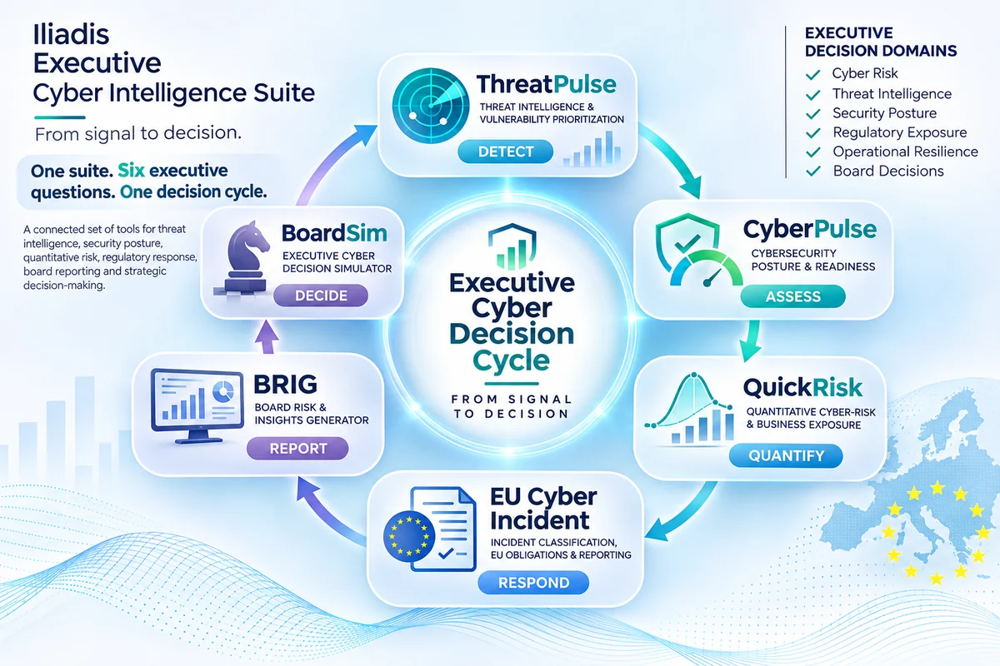
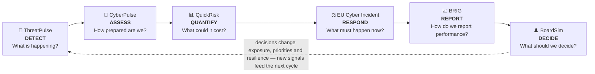
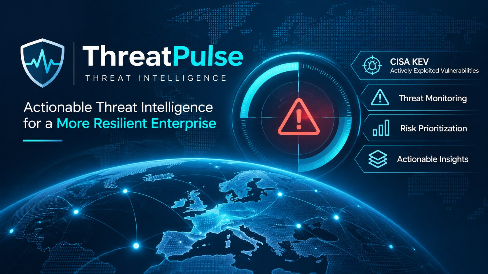
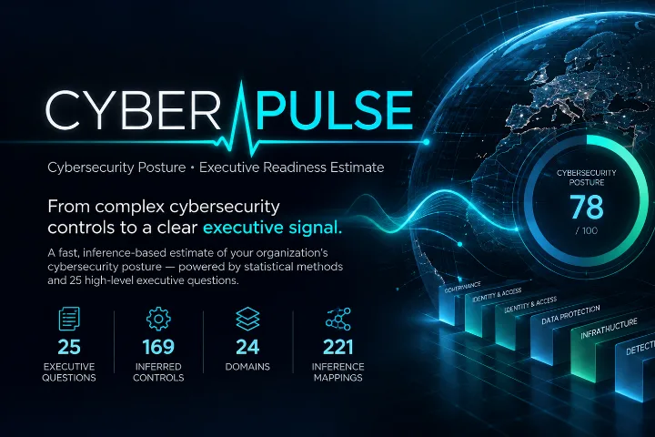
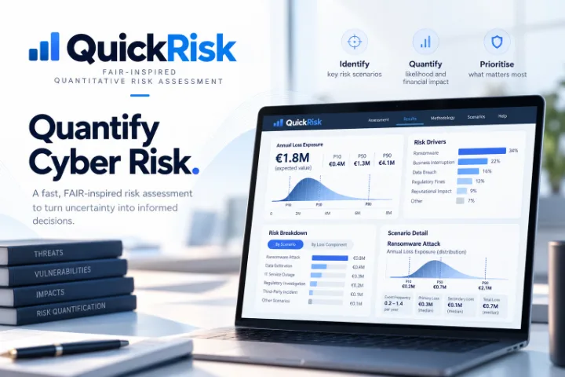
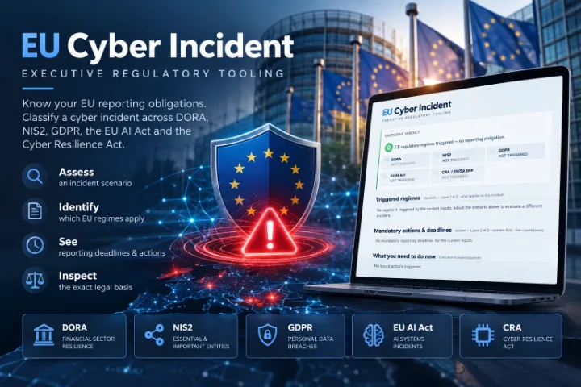
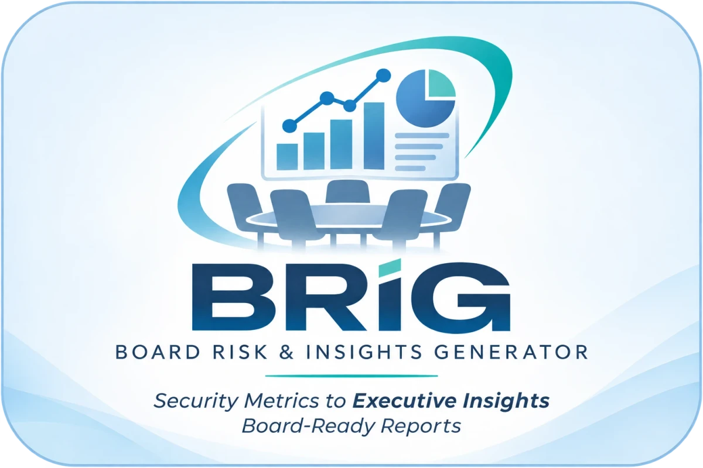
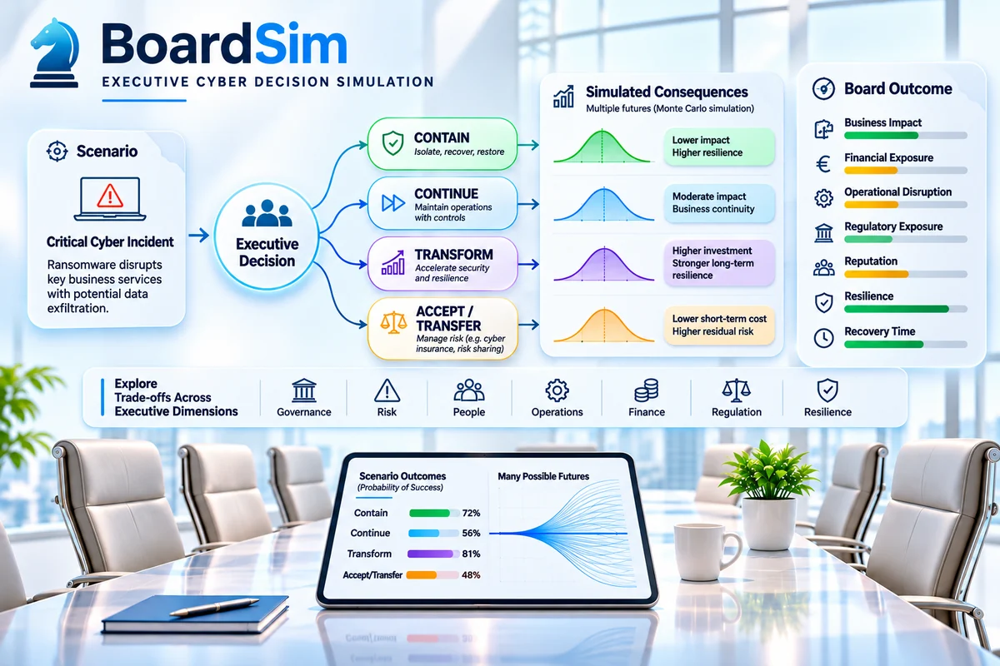
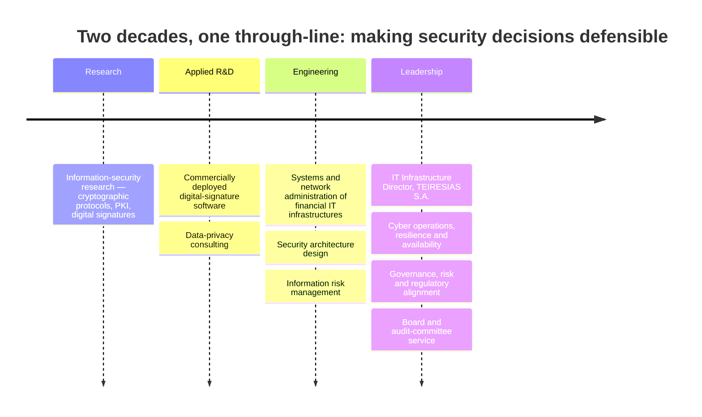

<!--
  GitHub profile README — Dr. John Iliadis
  Profile : https://github.com/johniliad
  Bridge  : https://github.iliadis.net   (GitHub Pages identity bridge)
  Toolkit : https://www.iliadis.net/tools4u.html
  This file is the single source of truth for the profile page and the custom domain.
-->

<div align="center">

<a href="https://www.iliadis.net/">
  
</a>

<h1>Dr. John ILIADIS</h1>

<h3>Technology &amp; Cybersecurity Executive · CIO / CISO / CTO Leadership</h3>

<p><em>Cyber resilience · secure architecture · zero trust · quantitative cyber risk · AI governance · EU regulatory alignment</em></p>

<p>
  <a href="https://www.iliadis.net/"></a>
  <a href="https://www.linkedin.com/in/johniliadis/"></a>
  <a href="https://github.com/johniliad"></a>
  <a href="https://orcid.org/0000-0002-0692-1535"></a>
  <a href="https://www.credly.com/users/john-iliadis/badges/credly"></a>
  <a href="https://github.iliadis.net"></a>
</p>


<br /><br />

<p>
  
  
  
  
  
  
</p>

</div>

<p align="center">
  <a href="#official-identity"><b>Identity</b></a> ·
  <a href="#executive-snapshot"><b>Snapshot</b></a> ·
  <a href="#what-i-lead"><b>Leadership</b></a> ·
  <a href="#the-executive-cyber-intelligence-suite"><b>The Suite</b></a> ·
  <a href="#open-source"><b>Open source</b></a> ·
  <a href="#how-these-tools-are-engineered"><b>Engineering</b></a> ·
  <a href="#selected-impact"><b>Impact</b></a> ·
  <a href="#credentials--education"><b>Credentials</b></a> ·
  <a href="#recognition"><b>Recognition</b></a> ·
  <a href="#research--publications"><b>Research</b></a> ·
  <a href="#connect"><b>Connect</b></a>
</p>

---

## Official identity

| Where | What it is |
| :-- | :-- |
| **This GitHub account** — [github.com/johniliad](https://github.com/johniliad) | The official public software, code and project profile of Dr. John Iliadis. |
| **Primary professional website** — [www.iliadis.net](https://www.iliadis.net/) | Executive profile, publications, talks, the Tools4U toolkit and contact details. |
| **Identity bridge** — [github.iliadis.net](https://github.iliadis.net/) | First-party GitHub Pages site for this account — the same person, documented once, in human- and machine-readable form. |
| **Source repository** — [johniliad/johniliad](https://github.com/johniliad/johniliad) | The public repository that renders both surfaces above: this profile README and the bridge page. It is where the record lives, not a further identity. |
| **LinkedIn** — [/in/johniliadis](https://www.linkedin.com/in/johniliadis/) | Professional history and endorsements. |
| **ORCID** — [0000-0002-0692-1535](https://orcid.org/0000-0002-0692-1535) | Persistent researcher identifier. |

> `github.iliadis.net` is **not** a separate person, company or brand. It is the first-party identity bridge for this account, served from this repository and owned by the same individual described at [www.iliadis.net](https://www.iliadis.net/). The canonical entity is always **John Iliadis** on **iliadis.net**; every other surface points back to it.

---

## Executive snapshot

| | |
| :-- | :-- |
| **Role** | IT Infrastructure Director — TEIRESIAS S.A., mission-critical financial infrastructure serving tens of thousands of clients |
| **Practice** | Cyber strategy &amp; governance · secure architecture · zero trust · cyber operations · quantitative cyber risk · cyber resilience · AI governance |
| **Experience** | 20+ years: information-security research → applied security R&amp;D → enterprise infrastructure engineering → technology and cybersecurity leadership |
| **Team** | Directs 18 professionals delivering cyber operations and service resilience |
| **Regulatory** | ISO 27001 · NIS2 · DORA · GDPR · EU AI Act · Cyber Resilience Act alignment |
| **Education** | PhD, Information &amp; Communication Systems Security (University of the Aegean) · MSc, Information Security (Royal Holloway, University of London) |
| **Credentials** | CISSP · CISM · CRISC · C&#124;CISO · ISSMP · CCSP · CCSK · CSSLP · SSCP · CMgr MCMI · COBIT · ITIL · DPO Executive |
| **Community** | ISC2 Hellenic Chapter — President of the Board (2023–2025), Chair of the Audit Committee (2025–present) |
| **Based in** | Athens, Greece |

> Leadership, to me, is the discipline of turning technical and regulatory complexity into decisions a board can act on — and then proving, with numbers, that the decision worked.

---

## What I lead

<table>
<tr>
<td width="50%" valign="top">

<h3>🛡️ Cyber strategy &amp; governance</h3>
<p>Security strategies traceable to business risk appetite — ISO 27001, NIS2, DORA, GDPR and AI-governance obligations translated into control decisions, not paperwork.</p>

<h3>🏛️ Secure architecture &amp; zero trust</h3>
<p>Design-stage cyber-risk assessment using ISO 27001 Annex A controls, architectural guardrails, and a zero-trust transition across enterprise infrastructure.</p>

<h3>📡 Cyber operations</h3>
<p>An outsourced Security Operations Centre with custom SOC use cases for internal incident-response coordination, and 24/7 operations for critical business services.</p>

</td>
<td width="50%" valign="top">

<h3>📊 Quantitative cyber risk</h3>
<p>FAIR-informed loss modelling, scenario analysis and risk-appetite statements — exposure expressed as a range of possible loss, with the assumptions on the table.</p>

<h3>🔁 Resilience engineering</h3>
<p>Disaster recovery, encrypted and deduplicated backup, availability engineering, and migrations that do not interrupt the business.</p>

<h3>🗣️ Executive communication</h3>
<p>Security performance in business language: board reporting, KPI/KRI design and — where the tool did not exist — building it.</p>

</td>
</tr>
</table>

---

## The Executive Cyber Intelligence Suite

<div align="center">
  <a href="https://www.iliadis.net/tools4u.html">
    
  </a>
</div>

A free CISO toolkit of six applications that answer the six questions a board actually asks about cyber risk: **what is happening, how prepared we are, what it could cost, what must happen when something goes wrong, how we report performance, and what we should decide.** They are not standalone utilities — they form one repeatable decision cycle, and each one operationalises a discipline I practise as a technology and cybersecurity executive.



| Stage | Application | Executive question | Open source |
| :-- | :-- | :-- | :-- |
| **Detect** | [ThreatPulse](https://threatpulse.iliadis.net/) | *What is happening?* | ✅ Apache-2.0 |
| **Assess** | [CyberPulse](https://www.iliadis.net/cyberpulse.html) | *How prepared are we?* | — |
| **Quantify** | [QuickRisk](https://quickrisk.iliadis.net/) | *What matters financially and operationally?* | ✅ Apache-2.0 |
| **Respond** | [EU Cyber Incident](https://www.iliadis.net/eucyber/) | *What happens if something goes wrong?* | — |
| **Report** | [BRIG](https://brig.iliadis.net/) | *How do we report performance?* | ✅ Apache-2.0 |
| **Decide** | [BoardSim](https://boardsim.iliadis.net/) | *What should we decide?* | ✅ Apache-2.0 |

<p align="center">
  <a href="https://www.iliadis.net/tools4u.html"></a>
  <a href="https://github.com/johniliad"></a>
  <a href="https://www.iliadis.net/contact/"></a>
</p>

---

### 🔭 Detect — ThreatPulse

<div align="center">
  <a href="https://threatpulse.iliadis.net/">
    
  </a>
</div>

> **The question it answers:** *what is happening?*

ThreatPulse is a threat-intelligence and vulnerability-prioritisation platform. It collects and normalises current threat information — the CISA Known Exploited Vulnerabilities catalogue, EPSS, CISA Vulnrichment, MITRE ATT&amp;CK, CAPEC, MISP Galaxy, ENISA EUVD, OSV, vendor PSIRTs, national CERT feeds and ransomware tracking — correlates observations into one threat record per CVE, enriches them with exploitation and detection context, and scores what deserves attention first. Security teams stop working through unfiltered feeds and start working through the items most likely to matter.

<p>
  <a href="https://threatpulse.iliadis.net/"></a>
  <a href="https://github.com/johniliad/ThreatPulse"></a>
  
  
  
</p>

<details>
<summary><b>How it is built — and the engineering evidence</b></summary>

- **Seven-stage, deterministic, fail-closed pipeline:** collect → normalise → correlate → enrich → score → quality gate → publish. Same inputs produce the same document; anything uncertain is refused, not guessed.
- **20+ source collectors** plus shared CVE-lookup and generic advisory engines, each reporting `ok` / `degraded` / `failed` — a degraded source falls back to a last-known-good snapshot, a required source aborts the run.
- **624 unit tests** across 26 test files; Python standard library only, so an unattended VM run cannot break on a moved transitive dependency.
- **A quality gate that refuses to transmit** a document failing structural, provenance, TLP or volume checks — a refusal is a run failure, never a warning.
- **TLP:CLEAR enforced twice:** at read time on ingestion, and again against the finished publication.
- **Stable identity:** a threat's identifier derives from the CVE alone (`sha256("threatpulse:cisa_kev:" + CVE)[:32]` as a UUID), so an identifier never changes because a different source won the scoring contest.
- **Public, read-only CTI API v1** (PHP + MySQL) with chunked publication kept under 7 MiB per request, field-level change history, source health and per-source attribution/licensing.
- **No invented numbers:** a score factor the evidence does not support is omitted and contributes nothing.

</details>

---

### 🧭 Assess — CyberPulse

<div align="center">
  <a href="https://www.iliadis.net/cyberpulse.html">
    
  </a>
</div>

> **The question it answers:** *how prepared are we?*

CyberPulse turns **25 high-level executive questions** into a directional, evidence-based read on cybersecurity posture — and highlights the areas that warrant further investigation. It is deliberately not another control-by-control questionnaire: it is the faster starting point an executive can complete without technical depth, using statistical inference and Monte Carlo analysis so that uncertainty in the inference is represented rather than hidden.

<p>
  <a href="https://www.iliadis.net/cyberpulse.html"></a>
  <a href="https://www.iliadis.net/cyberpulse.html"></a>
  
</p>

<details>
<summary><b>How it works</b></summary>

- **169 discrete security controls** across **24 functional domains**, operationalised through an assessment battery of roughly **200 diagnostic questions** and **221 inference mappings**.
- **Five maturity tiers** — Tier 0 (non-existent / ad hoc) to Tier 4 (optimised and continuously automated).
- **Probabilistic by design:** weighted mappings, applicability assumptions and Monte Carlo methods express the uncertainty between 25 answers and a much broader framework.
- **Derived from** the structure and control areas of an extensive national cybersecurity assessment framework associated with the Greek National Cybersecurity Authority, without claiming to be that framework or an official assessment.
- Published methodology, scoring logic and limitations; results are a **directional signal**, not an audit, certification or compliance verdict.

</details>

---

### 📊 Quantify — QuickRisk

<div align="center">
  <a href="https://quickrisk.iliadis.net/">
    
  </a>
</div>

> **The question it answers:** *what matters financially and operationally?*

QuickRisk is a FAIR-inspired quantitative cyber-risk assessment tool that expresses cyber exposure as a **range of possible loss** instead of a single, misleading score. Five common scenarios, two questions each and eight organisation-profile questions drive a server-side Monte Carlo simulation — results are returned as expected annual loss, P10/P50/P90 ranges and threshold-exceedance probabilities, with an explicit confidence indicator.

<p>
  <a href="https://quickrisk.iliadis.net/"></a>
  <a href="https://github.com/johniliad/QuickRisk"></a>
  
  
  
</p>

<details>
<summary><b>Engineering decisions worth reading</b></summary>

- **5,000 Monte Carlo iterations per scenario** by default; the model is explicit, versioned, documented and testable (`FAIR-QK-1.3`), and separate from the UI.
- **Zero retention by design:** questionnaire answers and results are never persisted — not in a database, file, PHP session, cookie, browser storage, cache, queue, log or third-party service. There is no account and no persistent results URL.
- **QuickRisk Live** (optional) is the single deliberate exception: an anonymous, TTL-bound session that a user explicitly saves — a deterministic SOC overlay producing a Real-Time Risk Index, a bounded SOC Threat Multiplier and an illustrative real-time EAL, with revocable read-only sharing and a six-scenario demonstration library. Its SOC telemetry is synthetic: no production SIEM, EDR or SOAR feed is connected.
- **One numeric implementation.** The risk engine is a pure TypeScript module; PHP and MySQL only validate, store and return what the engine calculated.
- **Audit trail:** calibration values are classified and documented, and an independent quantitative audit's findings and corrections are recorded in the repository.
- **Build-time guarantee:** the calibration file cannot be imported into the browser build — the build fails if you try.

</details>

---

### ⚖️ Respond — EU Cyber Incident

<div align="center">
  <a href="https://www.iliadis.net/eucyber/">
    
  </a>
</div>

> **The question it answers:** *what happens if something goes wrong?*

EU Cyber Incident is an **executive regulatory blast-radius and SLA engine**. It classifies an incident against DORA, NIS2, GDPR, the EU AI Act and the Cyber Resilience Act, then surfaces the obligations, deadlines and board actions that follow — in three layers: **which regimes are triggered**, **what must be done and by when** (live countdowns, soonest first), and **an executive and board playbook**. Every classification, deadline and action cites the exact EU provision it derives from, with EUR-Lex references a reader can open and verify.

<p>
  <a href="https://www.iliadis.net/eucyber/"></a>
  <a href="https://www.iliadis.net/eucyber/"></a>
  
</p>

<details>
<summary><b>How it works</b></summary>

- **Four input blocks, no sign-up:** entity type (DORA financial entity, NIS2 essential, NIS2 important, CRA manufacturer, non-regulated), awareness time, impact metrics (downtime hours, clients affected by count and percentage, financial counterparties, economic loss) and per-regime condition sets.
- **Regime-specific logic, not one generic checklist:** DORA conditions include critical or important function (CIF) impact, critical service outage, cross-border EU impact and data exfiltration; NIS2 covers severe operational disruption and material damage to third parties; GDPR covers personal-data breach and high risk to natural persons; the AI Act covers high-risk systems, death or severe harm to health, critical-infrastructure disruption and fundamental-rights breaches; the CRA covers digital products, actively exploited product vulnerabilities and severe product security incidents.
- **Deadline engine:** every action is ordered soonest-first with a live countdown from the moment of awareness.
- **Legally traceable by construction:** each output expands to the official legal text, including the DORA major-incident classification thresholds in RTS 2024/1772 (Article 1).
- **Honest boundaries:** a preliminary discovery and educational simulation aid — not legal, regulatory or professional advice; the disclaimer is gated before any verdict is displayed and is appended to printed and exported reports.

</details>

---

### 📈 Report — BRIG

<div align="center">
  <a href="https://brig.iliadis.net/">
    
  </a>
</div>

> **The question it answers:** *how do we report performance?*

**BRIG — Board Risk &amp; Insights Generator** turns cybersecurity metrics into a defensible board message. Select the measures you actually hold, enter current and comparison-period values, and BRIG analyses trend, directionality, relationships, contradictions, materiality and confidence to produce a concise board cybersecurity summary — with charts, one-page HTML, print/PDF and PowerPoint output.

<p>
  <a href="https://brig.iliadis.net/"></a>
  <a href="https://github.com/johniliad/BRIG"></a>
  
  
  
</p>

<details>
<summary><b>Why "deterministic-first" is the whole point</b></summary>

- **120-metric knowledge base** with full metadata, **53 metric-relationship heuristics**, and **31 story rules** plus dedicated contradiction rules — a report that explains itself, including "why did the generator say this?"
- **The complete report works with no AI at all.** The optional Executive Writing Layer may improve wording only; it can never alter numbers or facts, and its output is accepted only after schema and numeric-fact validation.
- **Deterministic chart selection** (Chart.js) driven by the analysis rather than by aesthetics, so the same data always produces the same board pack.
- **"Challenge the Story"** — a deterministic red-team pass on the draft narrative before a CISO presents it.
- **Four deliverables:** one-page HTML, A4-landscape print/Save-as-PDF, server-side PDF (File_PDF, with print-ready HTML fallback) and a seven-slide PowerPoint with speaker notes.
- **Privacy by default:** nothing is persisted unless a user explicitly saves a report; saved reports are opt-in, token-secured and expire. The production server runs Apache + PHP + MySQL with **no Node.js runtime**.
- **Golden-scenario tests** (A–J plus determinism and an end-to-end demo) keep the engine honest between releases.

</details>

---

### ♟️ Decide — BoardSim

<div align="center">
  <a href="https://boardsim.iliadis.net/">
    
  </a>
</div>

> **The question it answers:** *what should we decide?*

BoardSim is a board-level executive cyber decision simulator. It puts leadership inside a live scenario — ransomware disrupting key business services, with the possibility of data exfiltration — and forces the decision a board actually has to take: **contain and recover**, **continue operations with controls**, **transform security and resilience**, or **accept and transfer the risk**. Each option is simulated across multiple possible futures rather than a single forecast, so the trade-offs become explicit across business impact, financial exposure, operational disruption, regulatory exposure, reputation, resilience and recovery time.

It is not another risk score, dashboard or compliance calculator. It is the **decision layer** that turns what the rest of the suite produced into a defensible choice — including the consequences of the alternatives not taken.

<p>
  <a href="https://boardsim.iliadis.net/"></a>
  <a href="https://github.com/johniliad/BoardSim"></a>
  
  
  
</p>

<details>
<summary><b>Why a simulator, and what the repository proves</b></summary>

- **Server-authoritative by design.** The interface is a pure renderer: it never computes a score and never receives score deltas. The engine is implemented once, in PHP, where it can be pinned and tested.
- **A pinned specification.** The 29 Markdown design documents in `requirements/`, `scenarios/` and `engine/` are SHA-256 pinned and immutable; `bin/verify-manifest.php` re-hashes all 29, and `.gitattributes` normalises every text file to LF so a fresh clone on Windows verifies byte-for-byte instead of breaking on line endings.
- **Enumerated, not asserted.** `bin/enumerate.php` replays 2,268 decision paths and reproduces min 58 / max 84 / mean 71.15, with a determinism replay over the same corpus. Calibration reduced positional bias by 35%, and the dominance register is published rather than implied.
- **Three pins per run.** Regulatory bundle, scoring policy and scenario content are recorded with every run, so a decision replays against exactly the policy that scored it — not against today's.
- **Difficulty is a view, not a shortcut.** Leadership and executive views are measured separately and never merged; the board-crisis view refuses the request rather than guessing.
- **Privacy by construction.** The public demo needs no account, is unscored and unpersisted — the scorer is never constructed. Saved runs are opt-in; share links are hashed, revocable, read-only and expire after seven days; erasure is a physical delete.
- **Operational honesty.** Rate limiting answers `429` with `Retry-After`, one CSP and security-header policy is mirrored in Apache and drift-tested, and accessibility is measured — contrast ratios and target sizes are computed and asserted, not claimed.
- **No third-party runtime dependencies.** The engine runs on a plain PHP 8.2+ / MySQL host; the web build embeds React and uses MIT/ISC/BSD build tooling only. Deployment is checked too: `bin/verify-deploy.php` compares the served shell byte-for-byte with the local build, because a release that changes only PHP and HTML keeps the same JavaScript asset hash and would otherwise look deployed.

</details>

---

## Open source

Four of the six applications are published under **Apache-2.0**. They are small, self-hostable PHP/MySQL deployments — the kind of stack a security team can run on infrastructure it already controls, without a SaaS dependency.

| Application | Repository | Stack | Live | Licence |
| :-- | :-- | :-- | :-- | :-- |
| **ThreatPulse** | [`johniliad/ThreatPulse`](https://github.com/johniliad/ThreatPulse) | Python 3 (stdlib only) · PHP · MySQL | [threatpulse.iliadis.net](https://threatpulse.iliadis.net/) | Apache-2.0 |
| **QuickRisk** | [`johniliad/QuickRisk`](https://github.com/johniliad/QuickRisk) | React · TypeScript · PHP 8.2+ · MySQL (optional) | [quickrisk.iliadis.net](https://quickrisk.iliadis.net/) | Apache-2.0 |
| **BRIG** | [`johniliad/BRIG`](https://github.com/johniliad/BRIG) | React · TypeScript · Vite · Chart.js · PHP 8.3+ · MySQL (optional) | [brig.iliadis.net](https://brig.iliadis.net/) | Apache-2.0 |
| **BoardSim** | [`johniliad/BoardSim`](https://github.com/johniliad/BoardSim) | React · TypeScript · Vite · PHP 8.2+ · MySQL | [boardsim.iliadis.net](https://boardsim.iliadis.net/) | Apache-2.0 |
| *CyberPulse* | — | — | [CyberPulse](https://www.iliadis.net/cyberpulse.html) | closed source |
| *EU Cyber Incident* | — | — | [EU Cyber Incident](https://www.iliadis.net/eucyber/) | closed source |

<details>
<summary><b>Run any of them locally (verified commands from each repository)</b></summary>

**ThreatPulse** — the pipeline is standard-library Python, so there is nothing to install:

```bash
cd backend
python3 -m unittest discover -s tests -t .      # 624 tests
python3 run_pipeline.py --dry-run               # full pipeline, no publication
```

**BRIG** — Node 18+ for development; the deterministic engine runs entirely in the browser:

```bash
npm install
npm run dev        # http://localhost:5173 — works with no API
npm test           # Vitest golden scenarios A–J + determinism
npm run build      # tsc type-check + Vite build -> dist/
```

**QuickRisk** — Node 20+ and PHP 8.2+; one command runs the whole stack (model gate, build, PHP server):

```bash
node tools/serve-local.mjs                      # local app, no MySQL required

# verification gates
cd frontend && npm ci && npm run build          # type-check + guard checks + static build
php tests/run-tests.php                         # engine tests
php tools/validate-model.php                    # calibration/model validation gate
php tools/live-smoke.php                        # QuickRisk Live request flow, in-memory
```

**BoardSim** — Node 20+ to build the interface, PHP 8.2+ to serve it; no MySQL is needed for local work:

```bash
cd web && npm install && npm run build && cd ..  # build the SPA
php bin/dev.php                                  # http://127.0.0.1:8100 — file store, no MySQL

# verification gates
php bin/verify-manifest.php                      # re-hash the 29 pinned specification files
php bin/enumerate.php                            # 2,268 runs + determinism replay
php bin/verify-regulatory.php                    # 67 regulatory invariants
php bin/verify-scoring.php                       # 51 scoring invariants
```

`bin/dev.php` sets `BOARDSIM_DEV=1`, which swaps the MySQL store for a JSON file under `var/`; it exists so the front end can be developed without a database and must never be enabled on a public host.

Each repository carries its own methodology, deployment guide and disclaimers. Read them before relying on an output.

</details>

---

## How these tools are engineered

The same principles show up in all six applications, and they are the principles I hold to in production infrastructure.

- **Deterministic before clever.** A result must be reproducible from the same inputs and the same documented model version. AI, where present at all, may improve wording — never numbers, and never facts.
- **Fail closed.** A degraded feed, an unvalidated document or an ambiguous threshold stops the process rather than emitting something plausible. Refusal is a failure state, not a warning.
- **No invented numbers.** If the evidence does not support a factor, the factor is omitted and contributes nothing. Uncertainty is shown as a range, not hidden inside a point estimate.
- **Privacy by default.** No accounts, no persistence, no tracking beyond aggregate counts; the one place data can be saved is explicit, token-scoped and expires.
- **Legal traceability.** Every regulatory claim links to the provision it comes from, so a lawyer — not the tool — owns the conclusion.
- **Honest boundaries.** Assessment aids, not audits; directional signals, not certifications; simulations, not advice. Each application says so on its own pages and in print output.
- **Testable by other people.** Golden scenarios, determinism tests and unit suites ship in the repository so reviewers can try to break the logic themselves.

> **Disclosure:** all six applications are independently developed by Dr. John Iliadis. They are not official tools, assessments, certifications or endorsements of any authority, regulator or standards body — including CISA, ENISA, the Greek National Cybersecurity Authority or ISC2. They support, and never replace, professional judgement.

---

## Selected impact

<table>
<tr>
<td width="50%" valign="top">

<h3>🏦 In the enterprise</h3>
<ul>
<li><strong>+37% service availability</strong> across a 24/7 financial infrastructure serving tens of thousands of users.</li>
<li><strong>+85% disaster-recovery readiness</strong> — from an untested plan to exercised, measured recovery.</li>
<li><strong>Zero-downtime migration</strong> of enterprise infrastructure for tens of thousands of users.</li>
<li>An <strong>outsourced SOC</strong> with custom use cases for internal incident-response coordination.</li>
<li><strong>Design-stage cyber-risk assessment</strong> embedded in the architecture lifecycle (ISO 27001 Annex A).</li>
<li><strong>A zero-trust transition</strong> and an AI-governance framework aligned to the EU AI Act.</li>
</ul>

</td>
<td width="50%" valign="top">

<h3>🤝 In the community</h3>
<ul>
<li><strong>ISC2 Hellenic Chapter:</strong> membership <strong>+20%</strong>, event attendance <strong>+80%</strong>, sponsorships <strong>+150%</strong>, speaking invitations <strong>+50%</strong>, social following <strong>+24%</strong> (<strong>+100%</strong> in the prior term).</li>
<li>Elected to chapter leadership across <strong>three consecutive terms (2021–2027)</strong> — Board Member, then President of the Board, then Chair of the Audit Committee.</li>
<li><strong>ISC2 Global Achievement Award (EMEA)</strong> — the chapter recognised as the most impactful in the region during his board terms.</li>
<li><strong>CyberSecurity Leadership Awards</strong> (Boussias, 2022–2026).</li>
<li>Featured executive in the Greek <strong>Manager of the Year</strong> programme.</li>
</ul>

</td>
</tr>
</table>

---

## Career



**IT Infrastructure Director — TEIRESIAS S.A.** *(current)*
Directs the IT Infrastructure Business Unit: 24/7 resilient digital infrastructures serving tens of thousands of clients, an 18-person team, cyber operations under an outsourced SOC, disaster recovery and availability engineering, and the security-governance and risk decisions that sit behind them — delivered on time, on budget and on quality.

**Earlier chapters.** Information-security research → applied security R&amp;D (including commercially deployed digital-signature software) → enterprise infrastructure engineering and consulting on data privacy → ten-plus years leading teams that run IT and InfoSec operations, design InfoSec and data-privacy controls, and execute paradigm shifts of IT infrastructures.

---

## Credentials & education

<table>
<tr>
<td width="50%" valign="top">

<h3>🎓 Academic</h3>
<ul>
<li><strong>PhD</strong> — Information &amp; Communication Systems Security<br /><em>University of the Aegean</em></li>
<li><strong>MSc</strong> — Information Security<br /><em>Royal Holloway, University of London</em></li>
<li><strong>BSc</strong> — Computer Engineering</li>
<li>Diplomas and certificates in <strong>Management, Negotiation and Business Administration</strong></li>
</ul>

</td>
<td width="50%" valign="top">

<h3>📜 Professional certifications</h3>
<ul>
<li><strong>CISSP</strong> · <strong>CISSP-ISSMP</strong> · <strong>CCSP</strong> · <strong>CCSK</strong> · <strong>CSSLP</strong> · <strong>SSCP</strong> <em>(ISC2)</em></li>
<li><strong>CISM</strong> · <strong>CRISC</strong> · <strong>C&#124;CISO</strong> <em>(ISACA / EC-Council)</em></li>
<li><strong>CMgr MCMI</strong> — Chartered Manager <em>(CMI)</em></li>
<li><strong>COBIT</strong> · <strong>ITIL</strong> · <strong>DPO Executive</strong></li>
</ul>

</td>
</tr>
</table>

<p align="center">
  <a href="https://www.credly.com/users/john-iliadis/badges/credly"></a>
  <a href="https://orcid.org/0000-0002-0692-1535"></a>
  <a href="https://scholar.google.com/citations?user=sSCTevMAAAAJ"></a>
</p>

---

## Recognition

- **ISC2 Global Achievement Award** — the ISC2 Hellenic Chapter recognised as the most impactful chapter in the EMEA region, during his board terms.
- **CyberSecurity Leadership Awards** (Boussias) — multiple awards, 2022–2026.
- **Manager of the Year (Greece)** — featured executive profile in the national programme.
- **ISC2 EMEA** — featured speaker and community contributor; sessions listed in the ISC2 events catalogue.

---

## Community & board service

**ISC2 Hellenic Chapter** — three consecutive elected terms (2021–2027):

| Period | Role |
| :-- | :-- |
| 2021–2023 | Board Member — community engagement and member value |
| 2023–2025 | **President of the Board** |
| 2025–present | **Chair of the Audit Committee** |

**Advisory Board Member** — MSc in Law and Information &amp; Communication Technologies, University of Piraeus (2025–present).

<p align="center">
  <a href="https://isc2-chapter.gr/about-us/officers/"></a>
  <a href="https://masters.ds.unipi.gr/MSc_Law_ICT/advisory-board/"></a>
</p>

---

## Research & publications

Published researcher and invited speaker: **30+ articles and research papers** on cybersecurity strategy, CISO leadership, cyber risk, AI governance and cloud security, including **20+ international journal papers, conference papers and book chapters cited more than 300 times.**

<p align="center">
  <a href="https://www.iliadis.net/publications/"></a>
  <a href="https://orcid.org/0000-0002-0692-1535"></a>
  <a href="https://scholar.google.com/citations?user=sSCTevMAAAAJ"></a>
  <a href="https://www.researchgate.net/profile/John-Iliadis"></a>
  <a href="https://www.scopus.com/authid/detail.uri?authorId=6602634445"></a>
  <a href="https://openalex.org/authors/A5032481604"></a>
</p>

Invited keynotes, opening speeches and panel moderation at major cybersecurity conferences in Greece and across EMEA — and, where the format allows, white papers and tooling that let the audience reproduce the argument themselves.

---

## Toolchain

<p align="center">
  
</p>

<p align="center">
  
  
  
</p>

---

## Identity — machine-readable

The identity bridge at [github.iliadis.net](https://github.iliadis.net/) publishes a Schema.org graph whose `Person` `@id` is the canonical entity of the primary website — `https://www.iliadis.net/#john-iliadis` — so that both surfaces resolve to **one person**, not two competing records.

```json
{
  "@context": "https://schema.org",
  "@type": "ProfilePage",
  "@id": "https://github.iliadis.net/#profile",
  "url": "https://github.iliadis.net/",
  "name": "Dr. John Iliadis | GitHub & Technology Portfolio",
  "mainEntity": {
    "@type": "Person",
    "@id": "https://www.iliadis.net/#john-iliadis",
    "name": "John Iliadis",
    "honorificPrefix": "Dr.",
    "url": "https://www.iliadis.net/",
    "identifier": {
      "@type": "PropertyValue",
      "propertyID": "OpenPGP fingerprint",
      "value": "39F242B38AA4B5456AB8F95E5B0B2A360FA21D8E"
    },
    "sameAs": [
      "https://github.com/johniliad",
      "https://www.iliadis.net/",
      "https://github.iliadis.net/",
      "https://www.linkedin.com/in/johniliadis/",
      "https://orcid.org/0000-0002-0692-1535"
    ]
  }
}
```

`Person.identifier` carries the primary OpenPGP fingerprint as a Schema.org `PropertyValue` (`propertyID`: `OpenPGP fingerprint`) — the same 40-hex value the bridge page's *OpenPGP Identity* section displays — so a verifier can match a signature to this entity without parsing prose.

The same graph is embedded in the bridge's HTML (`index.html`) and declared through `<link rel="me">` links on both sides. Published endpoints: [github.iliadis.net](https://github.iliadis.net/) · [sitemap.xml](https://github.iliadis.net/sitemap.xml) · [robots.txt](https://github.iliadis.net/robots.txt).

The bridge also states **where it is published from**: `ProfilePage.isBasedOn` → `https://github.iliadis.net/#source-repository`, a `SoftwareSourceCode` node whose `codeRepository`, `author` and `about` all point at this repository and this person. That pair of edges — *this page comes from this code* and *this code is about this person* — is what ties the repository to the identity without pretending a repository is a person.

> Deliberately **not** in `Person.sameAs`: a repository is a work, not another profile of a human. `sameAs` stays reserved for surfaces that describe the same individual (GitHub account, website, LinkedIn, ORCID, Credly, Scholar).

---

## Connect

<table>
<tr>
<td width="50%" valign="top">

<h3>Professional</h3>
<ul>
<li><a href="https://www.iliadis.net/">Official website — iliadis.net</a></li>
<li><a href="https://www.linkedin.com/in/johniliadis/">LinkedIn — /in/johniliadis</a></li>
<li><a href="https://www.iliadis.net/leadership/">Executive profile</a></li>
<li><a href="https://www.iliadis.net/contact/">Contact</a></li>
</ul>

</td>
<td width="50%" valign="top">

<h3>Toolkit &amp; research</h3>
<ul>
<li><a href="https://www.iliadis.net/tools4u.html">Tools4U — the free CISO toolkit</a></li>
<li><a href="https://github.com/johniliad">GitHub — /johniliad</a></li>
<li><a href="https://www.iliadis.net/publications/">Publications</a></li>
<li><a href="https://www.iliadis.net/talks/">Talks</a></li>
</ul>

</td>
</tr>
</table>

**Open to** board and advisory roles, keynote invitations, guest lectures, and review of quantitative cyber-risk or security-reporting research. The fastest route is the [contact page](https://www.iliadis.net/contact/) or a [LinkedIn message](https://www.linkedin.com/in/johniliadis/).

<p align="center">
  <a href="https://www.iliadis.net/tools4u.html"></a>
  <a href="https://www.linkedin.com/in/johniliadis/"></a>
</p>

---

<div align="center">

<sub><strong>© 2002–2026 John Iliadis (Γιάννης Ηλιάδης) · Athens, Greece</strong></sub>

<sub>All applications shown here are independently developed, provided as-is, and constitute neither professional advice nor an audit, certification, assessment or endorsement by any authority, regulator or standards body. Validate every output against your own governance processes and qualified professional advice.</sub>

<sub>Identity bridge: <a href="https://github.iliadis.net">github.iliadis.net</a> · primary website: <a href="https://www.iliadis.net/">www.iliadis.net</a> · source: <a href="https://github.com/johniliad/johniliad">johniliad/johniliad</a></sub>

</div>
